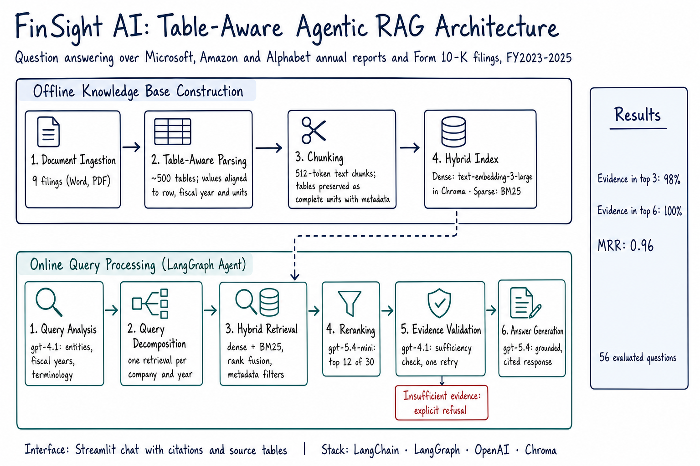
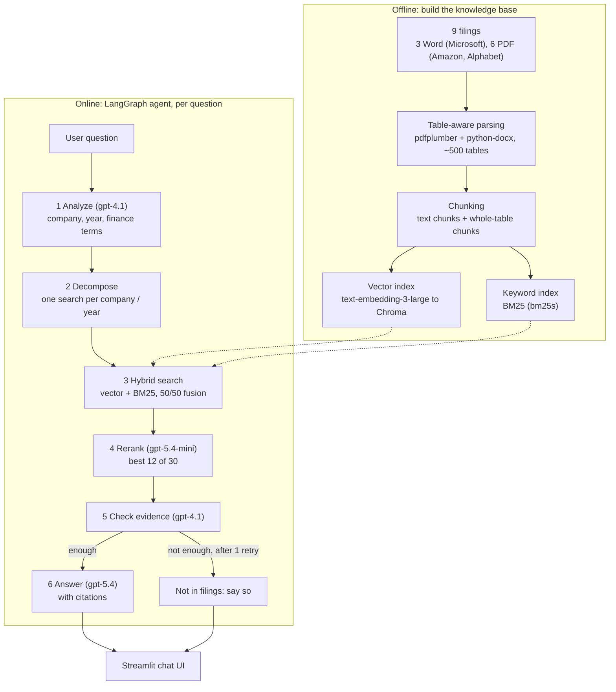

# FinSight AI: High-Level Design

**A table-aware, agentic RAG assistant that answers questions about Microsoft, Amazon and Alphabet from their annual reports and 10-K filings (FY2023–2025), with citations.**

---

## The problem

Financial filings are dense, and most of the important numbers live in **tables**. Standard RAG pipelines split documents into fixed-size text chunks, which breaks tables apart: a figure gets separated from its row label, its column year and its units. Ask "What was Google Cloud revenue in 2024?" and the system retrieves a fragment like `26,280 33,088 43,229` with no way to tell which number is 2024.

FinSight AI treats tables as first-class content: it parses them carefully, keeps them whole, and retrieves and cites them directly.

## How it works

The system has two halves: an **offline build** that turns filings into searchable knowledge, and an **online agent** that answers questions.

### 1. Table-aware parsing

| Source | Tool | What we fixed |
|---|---|---|
| Microsoft (Word) | `python-docx` | Merged header cells and stray `$` cells that shifted years over the wrong columns |
| Amazon, Alphabet (PDF) | `pdfplumber` | Borderless tables collapsing into one column; year headers sitting outside the detected table; paragraphs mistaken for tables; words glued together; captions separated from their tables |

The result is ~500 clean tables where every number sits under the right year, plus the surrounding text in reading order.

### 2. Chunking

- **Text**: 512-token chunks with 64 tokens of overlap (LangChain `RecursiveCharacterTextSplitter`). PDF line wraps are joined first so chunks don't start mid-sentence, and chunks never cross a section heading or a table.
- **Tables**: one chunk per table, or groups of rows with the header repeated for large tables. Every chunk carries its title, units, company, fiscal year, section and page.
- **Three views of every chunk**: a short **description** for the vector index, the **raw labels and figures** for keyword search, and the **markdown table** for the language model. This is LangChain's multi-vector pattern.

### 3. Indexes

| Index | Model / tool | Good at |
|---|---|---|
| Vector | OpenAI `text-embedding-3-large` (shortened to 1536 dimensions) in **Chroma** | Meaning: "cloud business" ≈ "Google Cloud" |
| Keyword | **BM25** (`bm25s`) with a finance tokenizer that keeps numbers like `107,556` whole | Exact terms and figures |

About 2,000 chunks. The indexes are built once on a laptop and shipped with the app.

### 4. The agent (LangGraph)

| Step | Model | What it does |
|---|---|---|
| 1 Analyze | `gpt-4.1` | Finds the companies and fiscal years, maps brands to parents (AWS → Amazon), and rewrites everyday terms into filing terms (capex → purchases of property and equipment) |
| 2 Decompose | — | Splits comparisons into one filtered search per company and year |
| 3 Hybrid search | — | Combines vector and keyword results (reciprocal rank fusion, 50/50) |
| 4 Rerank | `gpt-5.4-mini` | Reads the question with 30 candidates and keeps the best 12 |
| 5 Check evidence | `gpt-4.1` | Decides whether the excerpts actually answer the question; searches once more if not |
| 6 Answer | `gpt-5.4` (reasoning) | Answers only from the excerpts, cites every figure, shows its arithmetic |

If the answer isn't in the filings, or the question is about another company, the agent says so instead of guessing.

### 5. Chat UI (Streamlit)

Cited answers, expandable source excerpts with the original tables, follow-up questions ("and in 2023?"), and an optional trace showing how each answer was found.

## How we measured it

A hand-built **gold set of 61 questions** with answers taken from the filings: figure lookups, cross-company and cross-year comparisons, narrative questions, follow-ups, questions it should refuse, and **paraphrases** in everyday language ("capex", "EPS", "headcount").

Retrieval results for the final system, on the 56 questions that have evidence in the filings:

| Metric | Result |
|---|---|
| Right evidence in the top 3 | **98%** |
| All needed evidence in the top 6 (including comparisons) | **100%** |
| Mean reciprocal rank (1.0 = always first) | **0.96** |

The design choices that mattered most:
- **Query rewriting** into filing terminology: keyword search on everyday wording went from 24% to 88% hit rate.
- **A larger embedding model** (`text-embedding-3-large`): much better ranking for meaning-based search.
- **LLM reranking**: top-3 hit rate from 80% to 98%.

## Lessons learned

1. **Tables are where financial RAG breaks.** Most of the engineering went into parsing tables correctly, not into the model.
2. **Users and filings speak different languages.** Nobody types "purchases of property and equipment". Rewriting the query fixed more than any model change.
3. **Keyword search is underrated for finance.** Exact line items and figures matter; combining keyword and meaning search, then reranking, works best.
4. **Measure every change.** A small gold set with known answers turned guesses into decisions.
5. **Design the "I don't know" path.** A cited refusal is better than a confident wrong number.

## Tech stack

Python · LangChain · LangGraph · OpenAI (`gpt-4.1`, `gpt-5.4`, `gpt-5.4-mini`, `text-embedding-3-large`) · Chroma · bm25s · pdfplumber · python-docx · Streamlit

## Status

Built and evaluated: parsing, chunking, indexing, hybrid retrieval, reranking, agent, chat UI, retrieval evaluation.
Next: end-to-end answer evaluation, Replit deployment, demo.

---

*Diagram generated with the OpenAI image API (`gpt-image-2`) via [`scripts/generate_hld_diagram.py`](../scripts/generate_hld_diagram.py). Details of every decision and fix: [IMPLEMENTATION_LOG.md](IMPLEMENTATION_LOG.md).*
